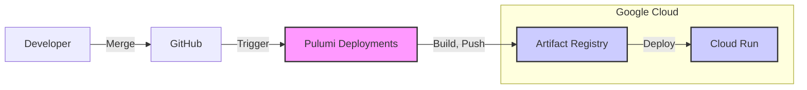

あけましておめでとうございます。 旧年中は大変お世話になりました。本年もEmobiをどうぞよろしくお願いいたします。

---

昨年よりEmobiでは、IaC基盤としてPulumiを採用しています。 
私自身、インフラの知識がほぼない状態からのスタートでしたが、書き慣れたTypeScriptを用いてIaCを構成できるため、難なく導入できました。

構成の概要はこのような感じです。



コードがマージされると、Pulumi Deployments上でDockerイメージがビルドされます。その後、Artifact Registryへのpushを経て、Cloud Runにデプロイされる流れです。

この構築を導入するにあたり、Pulumi Deployments環境からArtifact Registryへpushする際に権限不足のエラーが発生し、デプロイが止まってしまう問題が発生しました。今回はその解決策を共有します。

## 解決策

まず前提として、Pulumi DeploymentsがGoogle Cloudのサービスアカウントを使用できる状態にしておきます。 

https://www.pulumi.com/docs/deployments/deployments/oidc/gcp/

その上で、使用するサービスアカウントに`roles/iam.serviceAccountTokenCreator`（サービスアカウント トークン作成者）のロールを付与します。

Pulumiのコード内で`gcp.organizations.getClientConfig()`を実行すると、現在実行中のPulumi Deploymentsが使用しているサービスアカウントの情報を取得できます。
ここで得られるアクセストークンを`docker.Image`の`registry`プロパティに渡すことで、Dockerがその認証情報を用いてレジストリにpushできるようになります。

具体的には、ユーザー名に`oauth2accesstoken`を、パスワードに取得したトークンを指定します。

```ts
// 1. Artifact Registryのリポジトリを定義
const repository = new gcp.artifactregistry.Repository("my-repo", {
  description: "Docker repository",
  format: "DOCKER",
  location: "asia-northeast1",
  repositoryId: "app-repo",
});

// 2. 現在のPulumi実行コンテキストからGCPの認証情報を取得
// これにより、現在ログインしているユーザーまたはSAのトークンが取れる
const clientConfig = gcp.organizations.getClientConfig();

// 3. Dockerイメージのビルドとプッシュ
const image = new docker.Image("my-image", {
  // タグを含む完全なイメージ名
  imageName: pulumi.interpolate`${registryUrl}/my-app:v1`,
  build: {
    context: "./app", // Dockerfileがあるディレクトリ
  },
  
  // SAのトークンをDockerに渡してあげる
  registry: {
    server: pulumi.interpolate`${repository.location}-docker.pkg.dev`,
    username: "oauth2accesstoken", // 固定文字列
    password: clientConfig.then(config => config.accessToken), // トークンを渡す
  },
});
```

## 補足: 元々やっていた方法

解決策が見つかるまでは、Pulumiが実行される前に、サービスアカウントの認証情報が格納されているシェル変数`$GOOGLE_CREDENTIALS`の内容を一旦JSONファイルに書き出し、それを`gcloud auth login`に渡してADCを更新した後、`gcloud auth configure-docker`を実行するという手順を踏んでいました。

https://github.com/pulumi/pulumi-cloud-requests/issues/349#issuecomment-1907046863

いかにもその場しのぎな対応でモヤモヤしていたので、コードベースできれいに解決できてスッキリしました。
